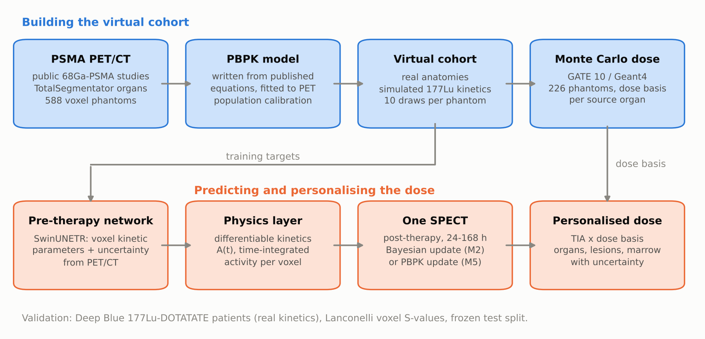
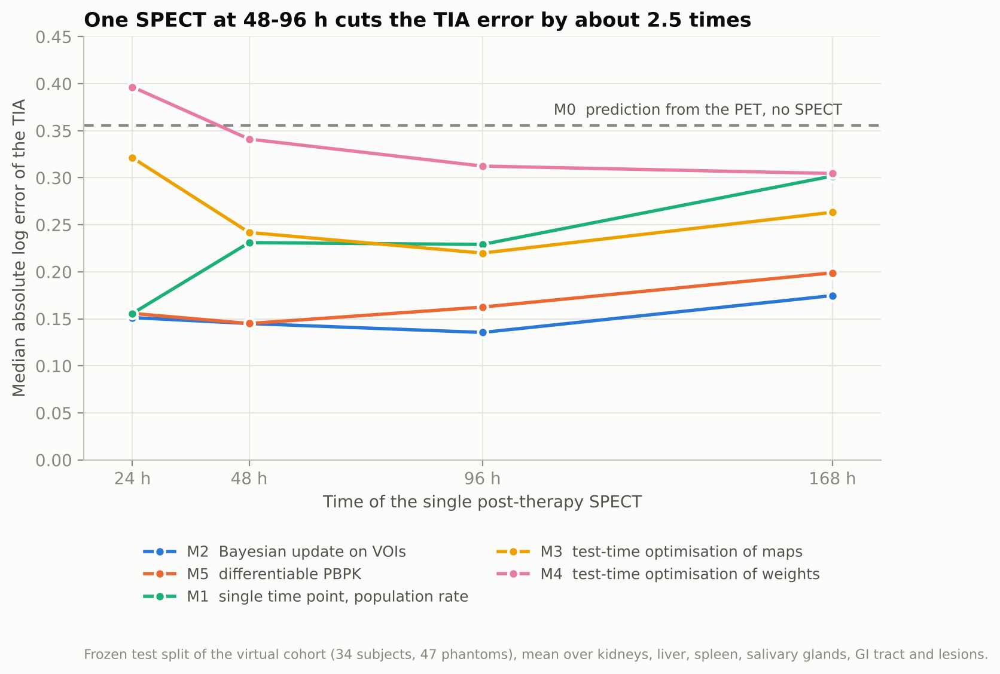
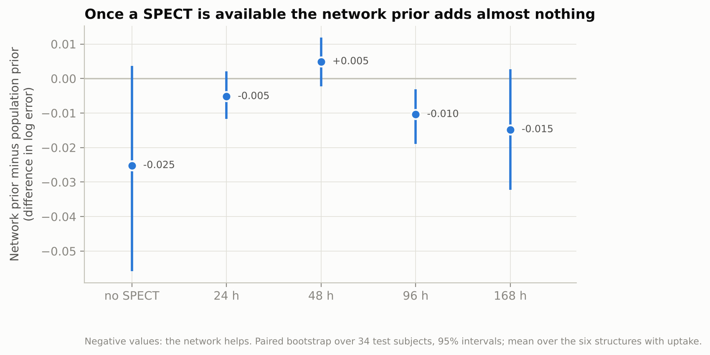
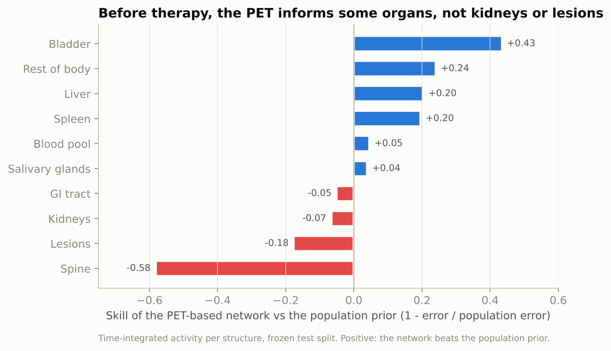
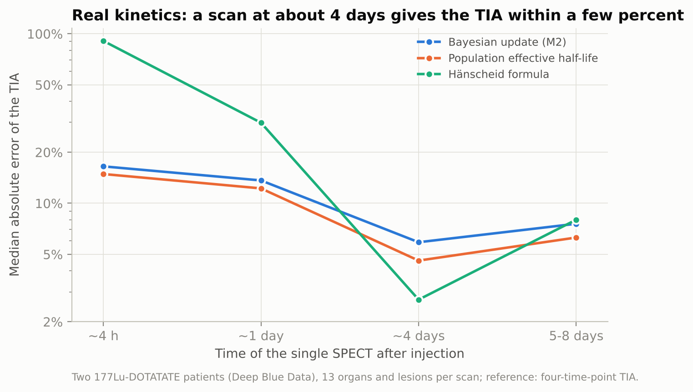
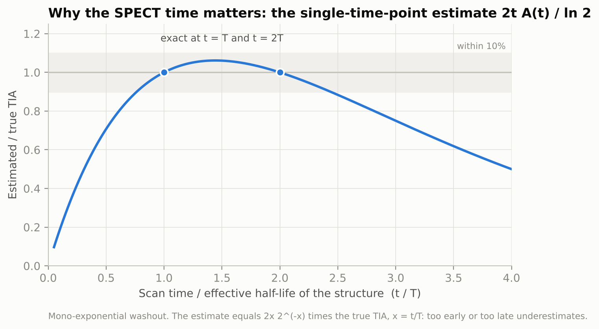

# Predictive dosimetry for [177Lu]Lu-PSMA therapy

How well can the absorbed dose of [177Lu]Lu-PSMA radioligand therapy be predicted from the pre-therapy PSMA PET/CT,
and how much does a single post-therapy SPECT add when it updates that prediction by Bayesian inference?

The project builds the whole chain: quantitative SPECT dosimetry on real patient kinetics, PSMA phantoms from public
PET/CT data, a physiologically based pharmacokinetic (PBPK) model fitted to the diagnostic PET, a virtual cohort with
Monte Carlo doses (GATE 10), a SwinUNETR that predicts voxel-wise kinetic parameters with uncertainty, and six methods
that update the prediction with one simulated SPECT. Methods in [`docs/methods.md`](docs/methods.md), aggregate
results in [`docs/results/`](docs/results/).



## Main findings

- One SPECT at 1-7 days reduces the error of the time-integrated activity (TIA) of organs and lesions from 0.36
  (prediction from the PET) to 0.14-0.18 (median absolute log error of the TIA) with a Bayesian update of the organ
  kinetics, with intervals close to nominal coverage (frozen test split of the virtual cohort). Dose errors follow TIA errors.
- Once that SPECT is available, a prior predicted from the PET by the network is not measurably better than a
  population prior: the PET at about 1 h informs the uptake of some organs, not the multi-day washout.
- A PBPK fit to the SPECT is as accurate as the Bayesian update but its intervals are too narrow; test-time
  optimisation of network maps or weights does not beat the Bayesian update.
- On two real 177Lu-DOTATATE patients, a SPECT at about 4 days recovers organ TIAs within a few percent with classical
  single-time-point methods; the Bayesian update reaches comparable accuracy and adds a calibrated interval.

All PSMA results come from a virtual cohort (real anatomies, simulated kinetics and doses); see the limitations in
`docs/methods.md`.

## Results at a glance











The figures are drawn from the aggregate tables in `docs/results/` by `scripts/analysis/make_readme_figures.py`
(details in `docs/figures/README.md`).

## Repository layout

| Path | Content |
|---|---|
| `notebooks/` | analysis notebooks by stage, numbered in order of dependency (`notebooks/README.md`); outputs cleared |
| `src/` | shared library, flat modules (`src/README.md`) |
| `scripts/` | command-line entry points: GATE kernels and patient Monte Carlo, cohort Monte Carlo runs, data download, analyses (`scripts/README.md`) |
| `deep_learning/` | network code: `main.ipynb` (Colab) with `lib/`, single-SPECT update scripts (M0-M5), report and dose scripts, frozen test pipeline `test_run.py`, tests |
| `docs/` | methods overview and aggregate results |
| `data/`, `output/` | empty; expected layout in their READMEs |

## Installation

Python 3.12. Two environments:

```bash
# base: notebooks, src/, scripts/ (includes GATE 10 / opengate; Geant4 data are fetched by opengate on first use)
uv venv .venv --python 3.12
uv pip install --python .venv/bin/python -r requirements.txt
.venv/bin/python -m ipykernel install --user --name lu177 --display-name "Python (lu177)"

# CPU torch: local update scripts (deep_learning/spect_update*.py, check_pbpk_torch.py) and the tests;
# spect_report.py, spect_dose.py, diagnose.py and test_run.py run in the base environment
uv venv .venv-torch --python 3.12
uv pip install --python .venv-torch/bin/python -r deep_learning/requirements_local_torch.txt \
    --extra-index-url https://download.pytorch.org/whl/cpu --index-strategy unsafe-best-match
```

Network training and TotalSegmentator need a GPU: `deep_learning/main.ipynb` and
`notebooks/02_psma_data/09_totalsegmentator.ipynb` run on Google Colab with Google Drive mounted. Set `DRIVE_ROOT`
in the configuration cell of `main.ipynb` (default `/content/drive/MyDrive/lu177`) and `LU177_DRIVE_PATH` for the
TotalSegmentator notebook; upload `deep_learning/`, `src/net_data.py` and the network data there.

## Data

No data is included (see [`DATA_LICENSES.md`](DATA_LICENSES.md)). Download the datasets from their official sources
and place them in `data/raw/` (or set `LU177_DATASET` to another folder):

| Dataset | Source | Folder |
|---|---|---|
| PSMA-PET-CT-Lesions (autoPET), NIfTI v3 | FDAT, doi:10.57754/FDAT.g27kx-86t35 (DICOM version on TCIA, doi:10.7937/r7ep-3x37; PET headers read from the public IDC bucket by `scripts/dataset/fetch_psma_pet_headers.py`) | `PSMA-PET-CT-Lesions_v3/` |
| Lu-177 DOTATATE anonymized patient datasets (Deep Blue, University of Michigan): multi-time-point SPECT/CT, VOIs, TIA maps | doi:10.7302/0n8e-rz46, 10.7302/vhrh-qg23, 10.7302/9nct-bk44 | `Deep Blue Dataset/patient_{4,6}/` |
| TotalSegmentator dataset (optional; the masks are produced by running TotalSegmentator on the PSMA CTs) | Zenodo, TotalSegmentator v2.0.1 | `Totalsegmentator_dataset_v201/` |

OpenDose S-values are downloaded by `scripts/dataset/fetch_opendose_svalues.py`. The reference values of
Lanconelli et al. 2012 are not redistributed; `scripts/analysis/compare_vsv_lanconelli.py` reads a table you supply.

## Reproducing

Run in this order (run times with a single workstation; details in the first cell of each notebook):

1. `notebooks/01_deepblue/` 01-07: Deep Blue loading, kinetics, voxel kinetics, dose (needs the water kernel of
   `scripts/gate/lu177_water_validation.py vsv`), Monte Carlo, single time point, Bayesian single time point.
2. `notebooks/02_psma_data/`: 08 inventory and split (after `scripts/dataset/fetch_psma_pet_headers.py`),
   09 TotalSegmentator (Colab), 11 phantoms (hours).
3. `notebooks/03_pbpk_and_cohort/`: 18 PBPK fit on the real PETs (about 2 h), 19 population calibration, 20 virtual
   cohort.
4. `scripts/gate/lu177_native_kernel.py`, `notebooks/04_monte_carlo/` 14-15, then `scripts/monte_carlo/run_mc_full.py`
   (about 5 days of CPU) and `scripts/monte_carlo/run_cohort_doses.py` (about 8 h).
5. `notebooks/05_cohort_doses/21_cohort_doses.ipynb`, `notebooks/06_netdata/22_network_data.ipynb`.
6. `deep_learning/main.ipynb` on Colab: checks, training, validation evaluation; then the local update scripts
   (`spect_update.py`, `spect_update_maps.py`, `spect_update_pbpk.py`, `spect_report.py`, `spect_dose.py`) and,
   once, the frozen test run (`deep_learning/test_run.py`: freeze, spect-data, Colab sections 10 and 12, local).

Tests:

```bash
.venv-torch/bin/python -m unittest discover -s deep_learning/tests
```

## Pretrained weights

The trained network of scenario A (`model.pth`, 256 MB) is attached to the
[v1.0 release](https://github.com/samkiwi18/lu177-psma-predictive-dosimetry/releases/tag/v1.0), not to the repository.
It holds the `model_state` of `KineticSwinUNETR` (`deep_learning/lib/model.py`, feature size 48, PET and CT as input
channels), the optimiser step and the validation NLL of the checkpoint. SHA-256:
`d6e2e8ffe118ced7ce804ddedeb890b491fc5b36fa85d68222a682c80e092d29`.

```python
import torch
from deep_learning.lib.model import KineticSwinUNETR

model = KineticSwinUNETR()
model.load_state_dict(torch.load("model.pth", map_location="cpu", weights_only=False)["model_state"])
model.eval()
```

To use it with the evaluation code, save it as `runs/best_A.pth`. The weights were trained on a virtual cohort built
from PSMA-PET-CT-Lesions (CC BY-NC 4.0) and are released under **CC BY-NC 4.0**, not MIT: non-commercial research
use only, with attribution.

## Citation and acknowledgements

Sources are in `references.bib`. Key ones: Kletting et al., PLoS One 2016 (PBPK model); Jeblick et al. 2026, PSMA-PET-CT-Lesions
(FDAT and TCIA); Dewaraja and Van, Deep Blue Data 2021, and Uribe et al., J Nucl Med 2021 (SNMMI
Lu-177 dosimetry challenge); Wasserthal et al. 2023 (TotalSegmentator); Sarrut et al. 2022 and 2026 (GATE);
Hatamizadeh et al. 2022 (Swin UNETR).

Deep Blue acknowledgement, as required by the data providers:

> We acknowledge Yuni Dewaraja at the University of Michigan for providing access to Lu-177 patient imaging data and
> segmentations obtained with support from R01EB022075 awarded by NIBIB and R01CA240706 awarded by NCI, NIH. Data were
> shared via the University of Michigan Deep Blue Data sharing repository.

## Development note

The code was written with the assistance of an AI coding assistant (Claude). The scientific design, the
methodological choices and the validation are the author's.

## Licence

Code: MIT (`LICENSE`). Pretrained weights, data and anything derived from the data: CC BY-NC 4.0 or the
terms of the source datasets, see `DATA_LICENSES.md`.
